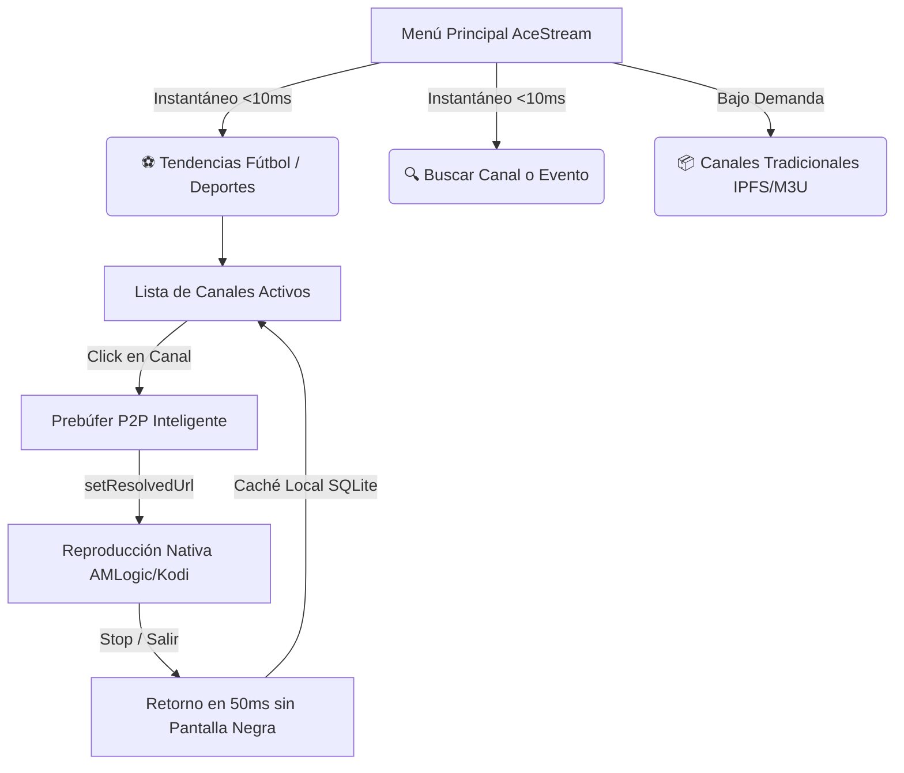

# Stremio for Kodi (plugin.video.stremio4kodi)

Complemento definitivo para Kodi que integra catálogos y addons de la comunidad Stremio, resolución Torrent con **TorrServer** y **Elementum**, integración profunda con **TMDB**, subtítulos automáticos gratuitos vía **OpenSubtitles v3**, y un centro de retransmisiones en vivo **AceStream** optimizado a 60 FPS con bypass DNS anti-bloqueo.

---

## Índice de Contenidos
1. [Novedades Recientes (v3.7.19)](#novedades-recientes-v3719)
2. [Características Principales](#características-principales)
3. [Guía Maestra de TorrServer: Configuración Óptima](#guía-maestra-de-torrserver-configuración-óptima)
   - [¿Por qué TorrServer en lugar de otros motores?](#por-qué-torrserver-en-lugar-de-otros-motores)
   - [Instalación y Configuración por Sistema Operativo](#instalación-y-configuración-por-sistema-operativo)
     - [Linux (PC / Servidor / NAS)](#1-linux-pc--servidor--nas)
     - [Windows (10 / 11)](#2-windows-10--11)
     - [Android / Google TV / Fire TV](#3-android--google-tv--fire-tv)
     - [CoreELEC / LibreELEC](#4-coreelec--libreelec)
     - [Docker (Cualquier plataforma)](#5-docker-cualquier-plataforma)
   - [Configuración en Stremio for Kodi](#configuración-en-stremio-for-kodi)
   - [Parámetros de Rendimiento Recomendados](#parámetros-de-rendimiento-recomendados)
4. [Centro AceStream: Deportes en Directo y Cero Lag](#centro-acestream-deportes-en-directo-y-cero-lag)
   - [Tendencias Deportivas y Reputación Comunitaria](#tendencias-deportivas-y-reputación-comunitaria)
   - [Buscador con Bypass DNS Anti-Bloqueo (DoH)](#buscador-con-bypass-dns-anti-bloqueo-doh)
   - [Aislamiento de la Lista Tradicional (IPFS / M3U)](#aislamiento-de-la-lista-tradicional-ipfs--m3u)
   - [Resolución Nativa y Eliminación de Pantalla Negra](#resolución-nativa-y-eliminación-de-pantalla-negra)
   - [Restauración Silenciosa al Detener la Emisión](#restauración-silenciosa-al-detener-la-emisión)
5. [Instalación del Addon](#instalación-del-addon)
6. [Estructura del Proyecto y Referencia de Módulos](#estructura-del-proyecto-y-referencia-de-módulos)
7. [Preguntas Frecuentes y Solución de Problemas](#preguntas-frecuentes-y-solución-de-problemas)

---

## Novedades Recientes (v3.7.19)

* **Restauración Silenciosa de Listas:** Al cortar una emisión en vivo, el menú de tendencias reaparece instantáneamente sin carteles emergentes molestos ni esperas, aprovechando la base de datos local ultrarrápida.
* **Resolución Nativa `setResolvedUrl`:** Eliminado para siempre el mensaje falso *"One or more items failed to play"* de Kodi.
* **Cero Congelaciones al Salir:** Supresión de capas timeshift problemáticas (`inputstream.ffmpegdirect`), logrando que el reproductor se cierre en 50 ms sin pantallas negras.
* **Menú AceStream Instantáneo (<10 ms):** Aislamiento de la pesada lista IPFS en su propio submenú inferior (`📦 Canales Tradicionales`), dando prioridad absoluta a las tendencias deportivas y al buscador en tiempo real.
* **Bypass DoH Integrado:** Evasión de bloqueos de operadoras (ISPs) a dominios de streaming mediante Cloudflare y Google DNS-over-HTTPS.

---

## Características Principales

* **Streaming P2P Eficiente:** Soporte completo de **TorrServer MatriX** (RAM pura sin degradar memorias flash eMMC) y **Elementum**.
* **Offloading Remoto:** Posibilidad de ejecutar el motor torrent o AceStream en un PC o NAS y reproducir fluidamente en un Smart TV o TV Box modesta.
* **Catálogos TMDB y Stremio:** Navegación por películas y series populares, en tendencia y por plataformas de streaming (Netflix, HBO Max, Disney+, Prime Video, Apple TV+).
* **OpenSubtitles v3 Integrado:** Descarga gratuita e instantánea de subtítulos sincronizados en español e inglés sin requerir cuenta ni claves API.
* **Base de Datos SQLite WAL:** Almacenamiento local optimizado para historiales, favoritos, reanudación de reproducción y caché ultrarrápida.

---

## Guía Maestra de TorrServer: Configuración Óptima

### ¿Por qué TorrServer en lugar de otros motores?

**TorrServer MatriX** (desarrollado por *YouROK*) es un servidor ligero escrito en Go que transforma cualquier archivo torrent o enlace magnet en un flujo HTTP de vídeo continuo con soporte de búsqueda temporal (*seek*).

A diferencia de clientes tradicionales:
1. **Protege la memoria de tu TV:** No necesita descargar el archivo completo al disco. Almacena en un búfer circular en **memoria RAM** los fragmentos que estás visualizando, protegiendo las memorias eMMC/flash de las TV Boxes y FireSticks del desgaste prematuro.
2. **Seek Instantáneo:** Permite avanzar o retroceder la película de forma inmediata solicitando al enjambre BitTorrent los bloques específicos del minuto deseado.
3. **Arquitectura Cliente / Servidor (La Joya de la Corona):** Puedes instalar TorrServer en tu ordenador o servidor doméstico y configurar Kodi en el televisor para que apunte a la IP de ese equipo. De este modo, **tu PC asume el 100% del trabajo pesado de red y conexiones**, y la TV Box solo reproduce un vídeo HTTP directo como si fuera YouTube o Netflix.

---

### Instalación y Configuración por Sistema Operativo

#### 1. Linux (PC / Servidor / NAS)

Para distribuciones como Ubuntu, Debian, Fedora o Arch Linux:

```bash
# 1. Descargar el binario más reciente de TorrServer MatriX (ejemplo amd64)
curl -s https://api.github.com/repos/YouROK/TorrServer/releases/latest \
  | grep "browser_download_url.*linux-amd64" \
  | cut -d '"' -f 4 \
  | wget -qi - -O torrserver

# 2. Dar permisos de ejecución y mover al PATH del sistema
chmod +x torrserver
sudo mv torrserver /usr/local/bin/

# 3. Crear servicio systemd para que arranque automáticamente
sudo tee /etc/systemd/system/torrserver.service <<EOF
[Unit]
Description=TorrServer MatriX Service
After=network.target

[Service]
Type=simple
User=$USER
ExecStart=/usr/local/bin/torrserver -p 8090 -d /var/lib/torrserver
Restart=always
RestartSec=3

[Install]
WantedBy=multi-user.target
EOF

# 4. Crear directorio de datos, habilitar e iniciar
sudo mkdir -p /var/lib/torrserver && sudo chown -R $USER:$USER /var/lib/torrserver
sudo systemctl daemon-reload
sudo systemctl enable --now torrserver
```
Comprueba el acceso abriendo en tu navegador: `http://localhost:8090` o `http://<IP-DEL-PC>:8090`.

---

#### 2. Windows (10 / 11)

1. Ve a los [Releases de TorrServer en GitHub](https://github.com/YouROK/TorrServer/releases).
2. Descarga el ejecutable `TorrServer-windows-amd64.exe`.
3. Renómbralo a `TorrServer.exe` y colócalo en una carpeta dedicada (ejemplo: `C:\Program Files\TorrServer\`).
4. Ejecútalo. En la primera apertura, Windows Defender Firewall preguntará si deseas permitir conexiones: marca **Redes privadas** y pulsa **Permitir acceso**.
5. *(Opcional para inicio automático)*: Presiona `Win + R`, escribe `shell:startup` y crea un acceso directo a `TorrServer.exe` en esa carpeta para que inicie junto con Windows en segundo plano.

---

#### 3. Android / Google TV / Fire TV

Si deseas ejecutar TorrServer directamente en el mismo televisor:
1. Descarga el archivo APK `TorrServe-MatriX-*-universal-release.apk` desde GitHub o vía Downloader.
2. Abre la aplicación TorrServer en tu televisor:
   * Pulsa en **Instalar servidor interno** o pulsa en **Iniciar**.
   * Concede los permisos de ejecución en segundo plano para que el sistema operativo no cierre el proceso al reproducir la película.

---

#### 4. CoreELEC / LibreELEC

En CoreELEC puedes ejecutar TorrServer de dos formas:
* **Opción A (Recomendada - Servidor Remoto):** Deja corriendo TorrServer en tu PC (`192.168.1.X:8090`) y configura la IP en los ajustes del addon de Kodi.
* **Opción B (Local mediante Docker):**
  Instala el addon oficial **Docker** desde el repositorio de CoreELEC y corre el contenedor con:
  ```bash
  docker run -d --name torrserver --net=host --restart=always -v /storage/.kodi/userdata/addon_data/torrserver:/opt/torrserver/db ghcr.io/yourok/torrserver:latest
  ```

---

#### 5. Docker (Cualquier plataforma)

Si utilizas Docker en un NAS (Synology, QNAP, Unraid) o servidor doméstico:

```bash
docker run -d \
  --name torrserver \
  --restart always \
  --net=host \
  -v /opt/torrserver/db:/opt/torrserver/db \
  ghcr.io/yourok/torrserver:latest
```

---

### Configuración en Stremio for Kodi

Una vez activo TorrServer, configúralo en el plugin dentro de Kodi:

1. Ve a **Add-ons** ➔ **Add-ons de vídeo** ➔ **Stremio for Kodi**.
2. Abre **Ajustes** y selecciona la pestaña **General**:
   * **Motor Torrent:** Selecciona `TorrServer`.
   * **TorrServer Host / IP:**
     * Si está en el mismo dispositivo (Android TV / PC): `127.0.0.1`
     * Si está en tu PC o servidor doméstico: La IP local del PC (ejemplo: `192.168.1.138`).
   * **TorrServer Puerto:** `8090` (por defecto).
   * **Autenticación:** Desactivada (salvo que hayas configurado usuario y contraseña en el panel web).
3. Pulsa **OK** para guardar.

---

### Parámetros de Rendimiento Recomendados

Abre la interfaz web de TorrServer en `http://<IP>:8090` y pulsa en el icono de engranaje (**Settings**):

| Parámetro | Dispositivo Modesto (TV Box / FireStick) | PC / Servidor / NAS | Propósito |
| :--- | :--- | :--- | :--- |
| **Cache size (Memoria RAM)** | `100 MB - 150 MB` | `500 MB - 1000 MB` | Tamaño del búfer circular en memoria para fragmentos descargados. |
| **Preload cache (Prebuffer)** | `5% - 10%` | `10% - 15%` | Porcentaje de búfer que debe llenarse antes de arrancar el vídeo. |
| **Reader read aheader** | `95%` | `95%` | Margen de lectura avanzada para evitar micro-parones. |
| **Torrents connect limit** | `20 - 30` | `50 - 100` | Límite de conexiones simultáneas para no saturar routers débiles. |
| **Save to database** | Desactivado | Desactivado | Evita escrituras innecesarias en disco; los torrents se gestionan en memoria volátil. |

> [!TIP]
> Si tienes problemas con archivos 4K HDR muy pesados (>40 GB), aumentar el tamaño de caché a **500 MB** en el PC garantiza que Kodi nunca experimente caídas de búfer durante escenas de alto bitrate.

---

## Centro AceStream: Deportes en Directo y Cero Lag

El plugin cuenta con una arquitectura de transmisión en vivo diseñada para no congelar los menús ni la interfaz de Kodi.



### Tendencias Deportivas y Reputación Comunitaria
* **Agregación Multifuente en Paralelo:** Escanea en milisegundos las tendencias de `acestreamid.com` y la API de `search-ace.stream`.
* **Semáforo y Puntuación Karma:** Cada canal muestra su reputación comunitaria en directo:
  * `●` Verde: Canal verificado y con peers activos en la red.
  * `+X / -Y`: Votos positivos vs negativos emitidos por la comunidad.
  * Origen del evento: `[AceStreamID]` o `[SearchAce]`.

### Buscador con Bypass DNS Anti-Bloqueo (DoH)
Para evitar que los bloqueos por DNS de las operadoras españolas (Movistar, Vodafone, Orange, Digi) redirijan dominios P2P a `127.0.0.1` o devuelvan páginas de bloqueo:
* El plugin incluye un interceptor a nivel de socket que resuelve las peticiones mediante **DNS-over-HTTPS (DoH)** consultando servidores de Cloudflare (`1.1.1.1`) y Google (`8.8.8.8`), garantizando acceso directo ininterrumpido.

### Aislamiento de la Lista Tradicional (IPFS / M3U)
* La lista masiva tradicional de canales IPFS se ha aislado en una carpeta dedicada al fondo del menú: `📦 Canales Tradicionales (Lista IPFS / M3U)`.
* Al entrar en AceStream, Kodi ya no congela la pantalla descargando listas gigantes; el menú abre instantáneamente.

### Resolución Nativa y Eliminación de Pantalla Negra
* **Uso exclusivo de `setResolvedUrl`:** Kodi recibe la URL resuelta mediante su API oficial de reproductores. Se eliminaron los falsos avisos *"One or more items failed to play"*.
* **Reproducción Directa sin Timeshift:** Se eliminó la dependencia de `inputstream.ffmpegdirect` en modo timeshift. Ahora el motor de Kodi reproduce el stream de forma nativa por hardware, permitiendo que al detener la emisión regrese al menú en solo 50 ms sin pantallas negras.

### Restauración Silenciosa al Detener la Emisión
* Al salir de un canal a pantalla completa, Kodi por diseño re-evalúa el contenedor para devolver el cursor al mismo canal.
* El plugin detecta que los datos ya están en la memoria caché local (`stremio4kodi.db`) y **suprime cualquier notificación emergente**, restaurando la lista de forma invisible e instantánea.

---

## Instalación del Addon

### Desde el Repositorio Oficial Sonvice (Recomendado)
Instalar el repositorio permite recibir todas las actualizaciones de forma automática:
1. En Kodi, ve a **Ajustes** ➔ **Explorador de archivos** ➔ **Añadir fuente**.
2. Introduce la URL directa del repositorio o descarga el archivo `repository.sonvice-*.zip` desde GitHub:
   ```
   https://github.com/sonvice/repository.sonvice
   ```
3. Ve a **Add-ons** ➔ **Instalar desde un archivo .zip** y selecciona el repositorio.
4. Luego ve a **Instalar desde repositorio** ➔ **Sonvice Repository** ➔ **Add-ons de vídeo** ➔ **Stremio for Kodi** ➔ **Instalar**.

### Instalación Manual Directa
```bash
# En sistemas basados en Linux / CoreELEC:
git clone https://github.com/sonvice/stremio4kodi.git
cp -r stremio4kodi /storage/.kodi/addons/plugin.video.stremio4kodi/
# Reiniciar Kodi
systemctl restart kodi
```

---

## Estructura del Proyecto y Referencia de Módulos

```
plugin.video.stremio4kodi/
├── addon.xml                  # Descriptor del complemento para Kodi 20/21
├── default.py                 # Punto de entrada de ejecución
├── service.py                 # Servicio en segundo plano para mantenimiento
├── subtitle_service.py        # Módulo de integración con el buscador de subtítulos
├── resources/
│   ├── settings.xml           # Definición gráfica de ajustes
│   ├── media/                 # Iconos y arte gráfico
│   ├── language/              # Archivos de traducción (Español / Inglés)
│   └── lib/
│       ├── acestream.py       # Cliente para el motor AceStream local / remoto
│       ├── acestream_search.py# Buscador multifuente, tendencias deportivas y bypass DoH
│       ├── cache.py           # Base de datos SQLite (WAL) para caché, favoritos e historial
│       ├── config.py          # Clase centralizada y tipada para lectura de ajustes
│       ├── debrid.py          # Soporte de resolución con Real-Debrid
│       ├── dht_search.py      # Búsqueda P2P directa en la red Kademlia DHT
│       ├── logger.py          # Sistema unificado de logging
│       ├── rottentomatoes.py  # Valoraciones críticas y del público
│       ├── router.py          # Enrutador principal de navegación y reproducción
│       ├── spanish.py         # Filtro inteligente de contenidos y audios en castellano
│       ├── stremio.py         # Cliente del protocolo HTTP v3 de addons de Stremio
│       ├── subtitles.py       # Descarga automática sin registro con OpenSubtitles v3
│       ├── tmdb.py            # Integración con The Movie Database
│       ├── torrent.py         # Resolución de streams para TorrServer y Elementum
│       └── ui.py              # Constructores de ListItems y diálogos de interfaz
```

---

## Preguntas Frecuentes y Solución de Problemas

### 1. ¿Por qué se recomienda TorrServer sobre Elementum en TV Boxes?
Porque Elementum utiliza el almacenamiento local para guardar partes del torrent y su base de datos, lo que en dispositivos con poca memoria flash (como Fire TV Sticks de 8GB o TV Boxes chinas) agota rápidamente el espacio disponible y degrada la memoria eMMC. TorrServer funciona **100% en la memoria RAM** y se destruye al cerrar el vídeo.

### 2. ¿Puedo usar TorrServer en mi PC y ver las películas en el televisor?
**Sí.** Solo necesitas asegurarte de que tu PC y la TV Box estén en la misma red local (Wi-Fi o cable). Pon la IP local de tu PC en los ajustes de TorrServer dentro de Kodi (`192.168.1.X`) y el puerto `8090`. Tu PC descargará el torrent y enviará el vídeo a la TV sin esfuerzo para esta última.

### 3. ¿TorrServer sirve para reproducir canales de AceStream?
**No.** TorrServer está programado exclusivamente para el protocolo BitTorrent estándar (archivos con tamaño cerrado como películas y series). AceStream utiliza un protocolo P2P propietario de retransmisión continua en vivo. Para AceStream, el addon se conecta a su propio motor local (`127.0.0.1:6878`).

### 4. ¿Por qué la lista de tendencias se vuelve a cargar al salir de una retransmisión?
Es el comportamiento nativo de Kodi para devolver el cursor al canal exacto que estabas viendo. En la versión v3.7.19, esta recarga se realiza de forma **completamente silenciosa en menos de 15 ms** desde la base de datos local, sin descargas por internet ni notificaciones en pantalla.

---

## Licencia

Este proyecto está licenciado bajo la **Licencia MIT** - consulta el archivo [LICENSE](LICENSE) para más detalles. Se permite su libre uso, modificación y distribución reconociendo la autoría original.
